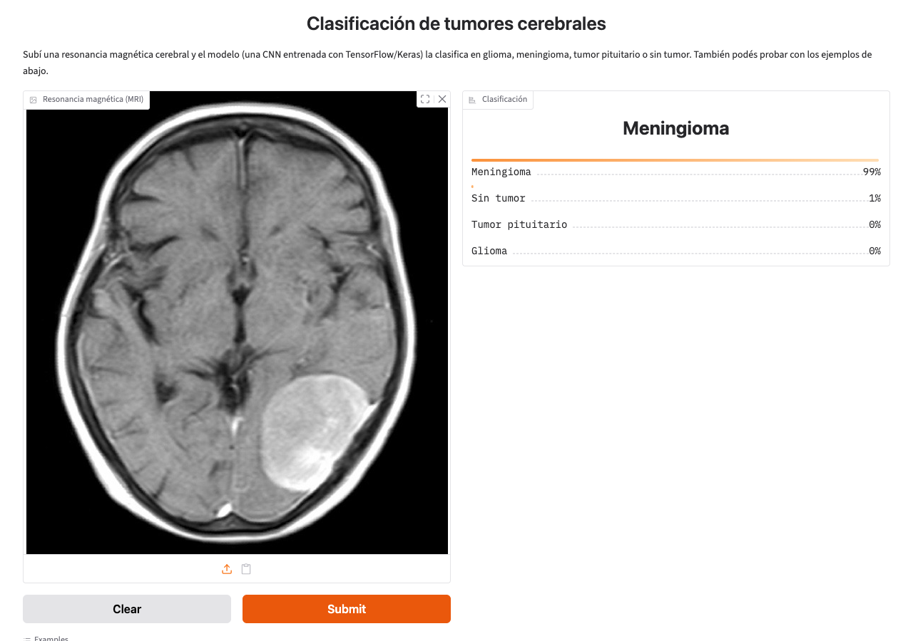

# Brain Tumor Classification

## _Tumor recognition via TensorFlow and Keras models_

This Python project classifies brain MRIs into 4 labels:

* Glioma
* Meningioma
* Pituitary tumor
* No tumor

Final project for *Procesamiento de Imágenes y Señales Biomédicas* by Valentina Sole and Martina Villar
(December 2023). The written report is in [`Trabajo Final.pdf`](Trabajo%20Final.pdf).

## Repository layout

| Path | What it is |
|---|---|
| `ConvolutionalTF.py` | Builds the datasets, trains the CNN and saves `model1.h5`, `Model1History.csv` and `training_curves.png` |
| `model1trained.py` | Loads `model1.h5` and reports train / validation / test accuracy. Also exposes `load_trained_model()` |
| `main.py` | Classifies one or more MRI images from the command line |
| `app.py` | Web interface: upload an MRI in the browser and see the predicted class with probabilities |
| `model1.h5` | The trained model (12 epochs) |
| `Model1History.csv` | Accuracy and loss per epoch of that training run |
| `Training/`, `Testing/` | The dataset, one sub-folder per class |
| `glioma.jpg`, `meningioma.jpg`, `no_tumor.jpg`, `pituitary.jpg` | Sample MRIs used by `main.py` when no image is given |
| `requirements.txt` | Pinned Python dependencies |
| `TP2/` | A previous assignment of the same course (shape classification with Hu moments). See below |

## Installation

Tested with Python 3.12. From the repository root:

```bash
python3.12 -m venv venv
source venv/bin/activate          # on Windows: venv\Scripts\activate
pip install -r requirements.txt
```

## Usage

**Web interface** (the trained model is included, no dataset needed):

```bash
python app.py
```

Then open http://127.0.0.1:7860 in your browser, drop an MRI image (or pick one of the examples) and
press *Submit*. The result shows the probability of each class.



**Classify an image from the command line:**

```bash
python main.py path/to/mri.jpg            # one or more images
python main.py                            # runs on the 4 sample images
```

Example output:

```
Imagen: glioma.jpg
Predicción: glioma
Confianza: 99.7%
Probabilidades: glioma=99.7%, meningioma=0.3%, notumor=0.0%, pituitary=0.0%
```

**Evaluate the trained model** on the train, validation and test sets (needs the dataset):

```bash
python model1trained.py
```

**Retrain from scratch** (needs the dataset, takes a while on CPU, overwrites `model1.h5`,
`Model1History.csv` and `training_curves.png`):

```bash
python ConvolutionalTF.py
```

## Dataset

The dataset is the [Brain Tumor MRI Dataset](https://www.kaggle.com/datasets/masoudnickparvar/brain-tumor-mri-dataset)
from Kaggle and is included in the repository:

| Class | Training | Testing |
|---|---:|---:|
| glioma | 1321 | 300 |
| meningioma | 1339 | 306 |
| notumor | 1595 | 405 |
| pituitary | 1457 | 300 |
| **Total** | **5712** | **1311** |

20% of `Training/` is held out as the validation set. Keras infers the classes from the sub-folder
names in alphabetical order, so if you change the classes also update `CLASS_NAMES` in `model1trained.py`.

A smaller and less specific dataset (divided into Tumor and No Tumor) can be found
[here](https://www.kaggle.com/datasets/navoneel/brain-mri-images-for-brain-tumor-detection). This is useful if
you are using a less powerful computer and it's taking a long time to build the model with the original dataset.
To use it, delete the contents of the `Training/` and `Testing/` folders and split the `Yes` and `No` folders
into them, like so:

* Training
    * Yes
    * No

## Model and results

A small sequential CNN: a `Rescaling` layer (0-255 to 0-1), three `Conv2D` + `MaxPooling2D` blocks
(16, 32 and 64 filters), `Dropout(0.2)`, `Flatten`, a `Dense(128)` layer and a `Dense(4)` output layer
that produces logits. Trained for 12 epochs with Adam and sparse categorical cross-entropy on 180x180 images.

Results of the included `model1.h5`:

| Set | Accuracy |
|---|---:|
| Train | 99.5% |
| Validation | 93.1% |
| Test | 92.9% |

Per-class recall on the test set: glioma 89.7%, meningioma 81.4%, notumor 99.3%, pituitary 99.3%.
Most errors are meningiomas predicted as glioma or pituitary. The gap between train and validation
accuracy shows the model overfits; `Model1History.csv` shows the validation loss stops improving
around epoch 9.

## Notes

* `model1.h5` was saved with Keras 2.15. Keras 3 cannot read its compile configuration, so
  `load_trained_model()` loads it with `compile=False` and compiles it again with the same settings.
  Models saved by the current `ConvolutionalTF.py` load the same way.
* Images are fed to the model exactly as Keras loaded them during training: RGB (grayscale MRIs are
  expanded to 3 identical channels), resized to 180x180 with bilinear interpolation, raw 0-255 values.

## TP2: shape classification (previous assignment)

`TP2/` is an earlier assignment of the same course and is independent from the tumor classifier. It
recognizes circles, stars and triangles in a webcam feed using Hu moments and a decision tree:

* `DescriptorGenerator.py` computes the Hu moments of the 30 reference images (`10circles/`, `10stars/`,
  `10triangles/`) and writes them to `data.xlsx`.
* `trainer.py` trains the decision tree from `data.xlsx` and saves `classifier.joblib`.
* `predictor.py` / `predictorNuevo.py` open the webcam and label the detected shapes. Press `q` to quit.

Run everything from inside the `TP2/` folder, with its own dependencies:

```bash
cd TP2
pip install -r requirements.txt
python trainer.py
python predictorNuevo.py
```
