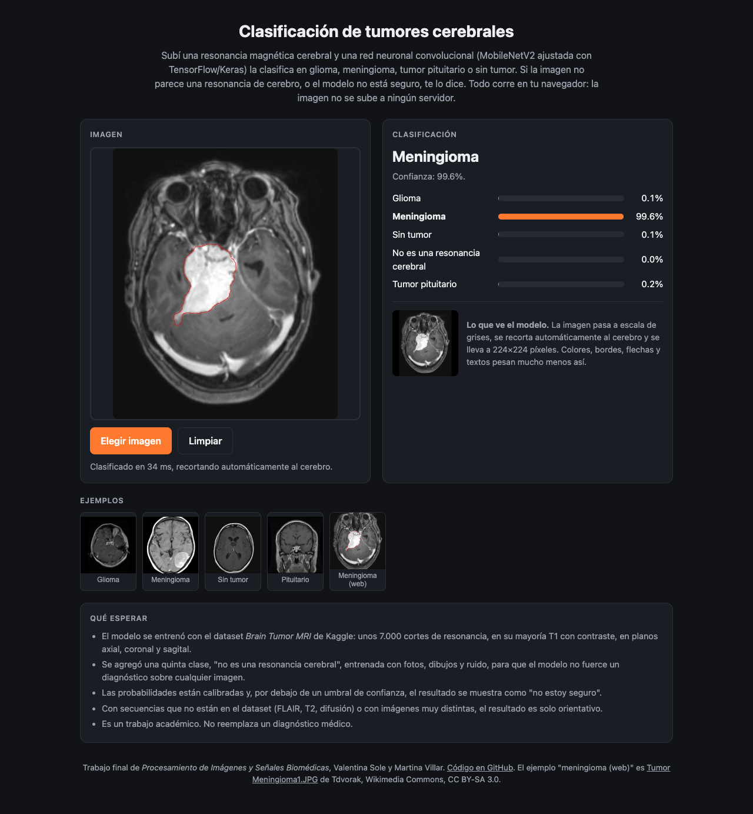
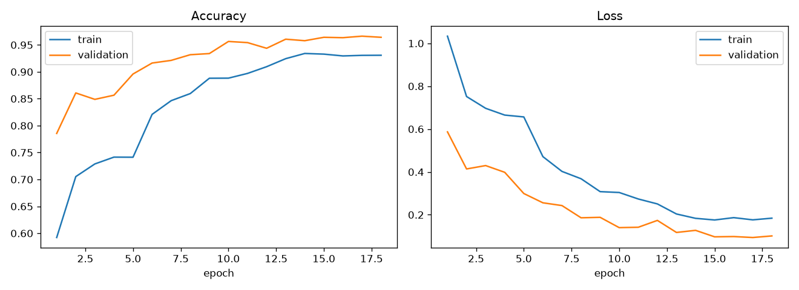

# Brain Tumor Classification

## _Tumor recognition via TensorFlow and Keras models_

This Python project classifies brain MRIs into 4 labels:

* Glioma
* Meningioma
* Pituitary tumor
* No tumor

and, since version 2, also tells you when an image is **not a brain MRI** or when it is **not sure**.

**Live demo: https://brain-tumor-clasification.vercel.app** — classify an MRI directly in your browser, nothing to install. The model runs client-side with TensorFlow.js, so the image never leaves your computer.



Final project for *Procesamiento de Imágenes y Señales Biomédicas* by Valentina Sole and Martina Villar
(December 2023). The written report is in [`Trabajo Final.pdf`](Trabajo%20Final.pdf). The v2 model and the web
version were added in October 2026.

## What changed in v2, and why

The original model (`model1.h5`, a small CNN trained from scratch) reaches 93% accuracy on the Kaggle test set, but
it falls apart on images that do not look exactly like the dataset: a FLAIR slice from a news site with an orange
overlay was classified "no tumor" with 100% confidence, a white border around a glioma turned it into "pituitary",
and random noise was "pituitary" too. Two reasons: the "no tumor" class of the dataset comes from a different source
than the three tumor classes (181 distinct image sizes vs. almost all 512×512), so the network learned "looks like a
web image = no tumor"; and a softmax classifier always answers with one of its four classes, confidently, even for a
photo of a cat.

v2 (`model2.keras`) attacks both problems:

| | v1 (2023) | v2 (2026) |
|---|---|---|
| Input | RGB, 180×180, whole image | grayscale, **cropped to the brain**, padded to a square, 224×224 |
| Network | 3-block CNN trained from scratch (4.0 M params) | **MobileNetV2** pre-trained on ImageNet, fine-tuned (2.3 M params) |
| Classes | 4 | 5: the 4 above plus **"other" = not a brain MRI** (photos, drawings, noise, text) |
| Augmentation | none | blur, JPEG, low resolution, frames, overlays, pointer lines, captions, noise, rotation, zoom, contrast |
| Probabilities | raw softmax | **temperature-scaled**, with a confidence threshold below which the answer is "not sure" |
| Dataset test accuracy | 92.9% | 96.9% |
| Real web images ([stress test](stress/RESULTS.md)) | 12/39 correct | 22/39 correct, 7 unsure, 10 wrong |

The crop removes most of the shortcuts (frame, resolution, captions, pointer lines outside the head), the grayscale
conversion removes color, the augmentation teaches the network to ignore the rest, the "other" class gives it a way
out for non-MRIs, and the calibration makes "100%" mean something. See [Model and results](#model-and-results) and
[Stress test](#stress-test) for the numbers, and [Known limitations](#known-limitations) for what it still cannot do.

## Repository layout

| Path | What it is |
|---|---|
| `preprocessing.py` | The v2 input pipeline: grayscale, brain crop, square padding, 224×224. Mirrored in JavaScript inside `web/index.html` |
| `prepare_data.py` | Runs the pipeline over `Training/` and `Testing/` into `data/processed/` and builds the "other" class (Imagenette photos + synthetic images) |
| `augment.py` | TensorFlow data augmentation used while training v2 (`python augment.py` writes a preview sheet) |
| `train_v2.py` | Trains MobileNetV2 in two phases, calibrates it and writes `model2.keras`, `calibration.json`, `Model2History.csv`, `training_curves_v2.png` |
| `classifier.py` | Loads a model and classifies PIL images; `Classifier` (v2) and `ClassifierV1` share one interface |
| `main.py` | Classifies one or more images from the command line (`--v1` for the old model) |
| `app.py` | Local web interface (Gradio): upload an MRI, see the verdict, the probabilities and what the model sees |
| `stress_test.py` | Runs both models on the images in `stress/` and writes `stress/RESULTS.md` |
| `stress/web/` | 39 real images from Wikimedia Commons with their expected class (`SOURCES.csv` has notes, licenses and source pages) |
| `stress/synthetic/` | Dataset test images degraded like web images (overlay, blur, low-res, JPEG, frame, contrast) plus non-MRI images |
| `web/` | Static web version deployed on Vercel: `index.html` + the model converted to TensorFlow.js (`web/model/`) + the example images (`web/examples/web_meningioma.jpg` is [Tumor Meningioma1.JPG](https://commons.wikimedia.org/wiki/File:Tumor_Meningioma1.JPG) by Tdvorak, CC BY-SA 3.0) |
| `tools/keras_to_tfjs.py` | Converts `model2.keras` to the TensorFlow.js format used by `web/` (also copies `calibration.json`) |
| `tools/h5_to_tfjs.py` | The same for the Keras 2 file `model1.h5` |
| `model2.keras`, `calibration.json` | The v2 model and its temperature / threshold / class names |
| `Model2History.csv`, `training_curves_v2.png` | Accuracy and loss per epoch of the v2 training run |
| `ConvolutionalTF.py`, `model1trained.py`, `model1.h5`, `Model1History.csv` | The original 2023 training script, evaluation script, model and history |
| `glioma.jpg`, `meningioma.jpg`, `no_tumor.jpg`, `pituitary.jpg` | Sample MRIs from the dataset used by `main.py` and `app.py` when no image is given (`glioma.jpg` is `Testing/glioma/Te-gl_0010.jpg` since v2; the previous sample, `Te-gl_0023.jpg`, is one of the test gliomas v2 gets wrong) |
| `Training/`, `Testing/` | The dataset, one sub-folder per class |
| `requirements.txt` | Pinned Python dependencies |
| `TP2/` | A previous assignment of the same course (shape classification with Hu moments). See below |

`data/` (processed dataset, downloaded photos, training logs) is generated and git-ignored.

## Installation

Tested with Python 3.12. From the repository root:

```bash
python3.12 -m venv venv
source venv/bin/activate          # on Windows: venv\Scripts\activate
pip install -r requirements.txt
```

## Usage

**Local web interface** (the trained model is included, no dataset needed):

```bash
python app.py
```

Then open http://127.0.0.1:7860 in your browser, drop an MRI image (or pick one of the examples) and
press *Submit*. You get the verdict, the probability of each class and the 224×224 gray crop the model
actually looked at.


**Classify an image from the command line:**

```bash
python main.py path/to/mri.jpg            # one or more images
python main.py                            # runs on the sample images
python main.py --v1 path/to/mri.jpg       # the original 2023 model
```

Example output:

```
Imagen: glioma.jpg
Predicción: Glioma
Confianza: 100.0%
Probabilidades: glioma=100.0%, meningioma=0.0%, notumor=0.0%, other=0.0%, pituitary=0.0%
```

When the image is not a brain MRI the prediction reads `No parece una resonancia cerebral`, and when the best class
is below the confidence threshold it reads `No estoy seguro (lo más probable: ..., ..%)`.

**Stress test** (both models on the images in `stress/`, about 2 minutes on CPU):

```bash
python stress_test.py                     # writes stress/RESULTS.md
```

**Retrain v2** (needs the dataset; about 45 minutes on an Apple M1 CPU; the first step downloads 94 MB of photos):

```bash
python prepare_data.py                    # -> data/processed/{train,test}/<class>/*.png
python train_v2.py                        # -> model2.keras, calibration.json, Model2History.csv, training_curves_v2.png
python tools/keras_to_tfjs.py model2.keras web/model    # refresh the web version
```

**Evaluate or retrain the original model** (v1):

```bash
python model1trained.py                   # train / validation / test accuracy of model1.h5
python ConvolutionalTF.py                 # retrain from scratch, overwrites model1.h5
```

## Dataset

The dataset is the [Brain Tumor MRI Dataset](https://www.kaggle.com/datasets/masoudnickparvar/brain-tumor-mri-dataset)
from Kaggle and is included in the repository:

| Class | Training | Testing |
|---|---:|---:|
| glioma | 1321 | 300 |
| meningioma | 1339 | 306 |
| notumor | 1595 | 405 |
| pituitary | 1457 | 300 |
| **Total** | **5712** | **1311** |

20% of `Training/` is held out as the validation set (same split, seed 123, for both models). Keras infers the
classes from the sub-folder names in alphabetical order.

Be aware of the source bias: the three tumor classes come from the Figshare dataset (almost all 512×512 slices,
T1-weighted with contrast) while `notumor` was collected separately (181 distinct image sizes in a 300-image sample).
Any model trained on it can learn to tell the sources apart instead of the pathology; v2 reduces this with the brain
crop and the augmentation, but does not remove it (see [Known limitations](#known-limitations)).

For v2, `prepare_data.py` adds a fifth class, **other**, with 1400 training and 350 test images that are not brain
MRIs: 1000 + 250 photos from [Imagenette](https://github.com/fastai/imagenette) (a 10-class subset of ImageNet,
downloaded on first run) and 400 + 100 synthetic images (noise, flat colors, gradients, shapes, text, stripes). All of
them go through the same preprocessing as the MRIs.

## Model and results

### v1 (`model1.h5`, 2023)

A small sequential CNN: a `Rescaling` layer (0-255 to 0-1), three `Conv2D` + `MaxPooling2D` blocks
(16, 32 and 64 filters), `Dropout(0.2)`, `Flatten`, a `Dense(128)` layer and a `Dense(4)` output layer
that produces logits. Trained for 12 epochs with Adam and sparse categorical cross-entropy on 180x180 RGB images.

| Set | Accuracy |
|---|---:|
| Train | 99.5% |
| Validation | 93.1% |
| Test | 92.9% |

Per-class recall on the test set: glioma 89.7%, meningioma 81.4%, notumor 99.3%, pituitary 99.3%.

### v2 (`model2.keras`, 2026)

`Input(224, 224, 3)` → `Rescaling` to -1..1 → MobileNetV2 (ImageNet weights, no top) → `GlobalAveragePooling2D` →
`Dropout(0.3)` → `Dense(5)` logits. One flat functional model, 2.26 M parameters. The three input channels carry the
same gray image, so the pre-trained filters can be reused.

Training (`train_v2.py`): phase 1 trains only the new head for 4 epochs with the base frozen (Adam 1e-3); phase 2
unfreezes the blocks from `block_10_expand` upwards (BatchNorm layers stay frozen) and fine-tunes with Adam 1e-4,
`ReduceLROnPlateau` and `EarlyStopping` on the validation loss (patience 4, best weights restored), up to 14 epochs.
Every training image is augmented on the fly by `augment.py`. Then the temperature *T* that minimizes the validation
NLL is fitted and stored in `calibration.json` together with the confidence threshold (0.7).

Results of the included `model2.keras` (18 epochs, *T* = 1.1):

| Set | Accuracy | Coverage at threshold 0.7 | Accuracy when confident |
|---|---:|---:|---:|
| Validation | 96.6% | 96.0% | 98.2% |
| Test | 96.9% | 96.3% | 98.2% |

Per-class recall on the test set: glioma=94.0%, meningioma=91.8%, notumor=98.8%, other=100.0%, pituitary=98.7%.

"Coverage" is the share of images on which the model commits to an answer; on the rest it says "not sure".



## Stress test

Accuracy on the Kaggle test set says little about images from anywhere else, so `stress_test.py` runs both models
on two sets of images with a known expected class and writes [`stress/RESULTS.md`](stress/RESULTS.md):

* **Real images from the web**: 39 Wikimedia Commons images (`stress/web/`): gliomas, meningiomas and pituitary
  adenomas in T1, T1 with contrast and T2, normal brains in T2, FLAIR, ADC and inversion recovery, images with
  arrows, boxes and captions, multi-panel figures, and non-MRIs (chest and hand X-rays, a knee and a lumbar spine
  MRI, a CT, a histology slide, a cat, a photo of a hospital workstation).
* **Dataset images degraded like web images**: 8 test images × 7 variants (original, orange overlay + pointer line +
  caption, blur, 100 px, JPEG quality 20, white frame, contrast ×1.8) plus 5 non-MRI images (`stress/synthetic/`).

| Set | v1 | v2 |
|---|---|---|
| Real web images (39) | 12/39 correct | 22/39 correct, 7 unsure, 10 wrong |
| Degraded dataset images + non-MRIs (61) | 45/61 correct | 54/61 correct, 6 unsure, 1 wrong |

A "not sure" answer is neither right nor wrong: the model declined. v1 cannot decline and has no "other" class, so it
is wrong by construction on every non-MRI.

Where v2 stands on the real web images: normal brains 9/10 (including FLAIR, ADC, coronal T2 and an inversion
recovery slice with an arrow), non-MRIs 7/8 plus 1 unsure (the CT), meningiomas 6/9, pituitary adenomas 1/4, and
**gliomas 0/9** (4 unsure, 5 wrong). Most of those gliomas are T2 or non-contrast T1 slices or scans of film prints,
which the dataset barely contains, and the model calls them "no tumor": that is the residue of the source bias
described above, now visible as a measured number instead of a surprise. On the degraded dataset images v2 is right
on 54 of 61 (v1: 45): it declines 6 times (two of the eight base images under annotation, blur, frame or contrast
change) and is confidently wrong once, on a "no tumor" image saved at JPEG quality 20.

## Web version (Vercel)

`web/` is a static page that loads the model with [TensorFlow.js](https://www.tensorflow.org/js) and classifies the
image inside the browser. There is no server: Vercel only serves the HTML, the 4.5 MB model and the example images.
It is live at https://brain-tumor-clasification.vercel.app.

* `web/index.html` re-implements `preprocessing.py` in JavaScript (grayscale with the same luma weights, background
  estimate from the border, opening, largest blob, bounding box, black square padding, 224×224) and applies the
  temperature and threshold from `web/model/calibration.json`. On the same preprocessed input, the browser and
  Python logits agree to within 0.02 (the web weights are stored as float16).
* `web/model/` was generated with `tools/keras_to_tfjs.py`, which rewrites the Keras 3 config into the Keras 2
  format TensorFlow.js understands and writes the weights as one float16 shard. Regenerate it after retraining:

  ```bash
  python tools/keras_to_tfjs.py model2.keras web/model
  ```

* Run it locally with any static server, for example `python -m http.server 8000 --directory web`, and open
  http://localhost:8000.
* Deploy with the [Vercel CLI](https://vercel.com/docs/cli) from inside `web/` (`cd web && npx vercel --prod`), or
  import the GitHub repository in Vercel and set **Root Directory** to `web`.

The Gradio app (`app.py`) cannot be deployed to Vercel as-is: TensorFlow exceeds the serverless function size limit
and Gradio needs a long-running server. Hugging Face Spaces is the usual free host for Gradio apps.

## Known limitations

* **It only knows the sequences it was trained on.** The dataset is essentially T1-weighted (mostly with contrast).
  FLAIR, T2, diffusion or CT images are out of distribution; v2 usually answers "not sure" or "other" on them, which is
  the honest answer, but it can also be confidently wrong. Fixing this needs training data of all four classes in
  those sequences, which is not freely available (BraTS has FLAIR but only gliomas).
* **The source bias of the "no tumor" class remains in the data.** The crop and the augmentation make it harder to
  exploit, not impossible.
* **The "other" class covers gross non-MRIs**, not "a different body part in MRI": a knee or spine MRI may still be
  called a brain class. The stress test shows which ones.
* **One 2D slice, no clinical context, dataset labels.** This is a course project, not a medical device.

## Notes

* `model1.h5` was saved with Keras 2.15. Keras 3 cannot read its compile configuration, so `ClassifierV1` and
  `model1trained.py` load it with `compile=False`. `model2.keras` is a native Keras 3 file.
* v1 images are fed exactly as Keras loaded them during training: RGB, 180x180 bilinear, raw 0-255 values. v2 images
  go through `preprocessing.prepare()`; the model's `Rescaling` layer maps 0-255 to -1..1 internally.
* `prepare_data.py` and `train_v2.py` are deterministic given the seed (123), up to TensorFlow's CPU nondeterminism.

## TP2: shape classification (previous assignment)

`TP2/` is an earlier assignment of the same course and is independent from the tumor classifier. It
recognizes circles, stars and triangles in a webcam feed using Hu moments and a decision tree:

* `DescriptorGenerator.py` computes the Hu moments of the 30 reference images (`10circles/`, `10stars/`,
  `10triangles/`) and writes them to `data.xlsx`.
* `trainer.py` trains the decision tree from `data.xlsx` and saves `classifier.joblib`.
* `predictor.py` / `predictorNuevo.py` open the webcam and label the detected shapes. Press `q` to quit.

Run everything from inside the `TP2/` folder, with its own dependencies:

```bash
cd TP2
pip install -r requirements.txt
python trainer.py
python predictorNuevo.py
```
